<div align="center">

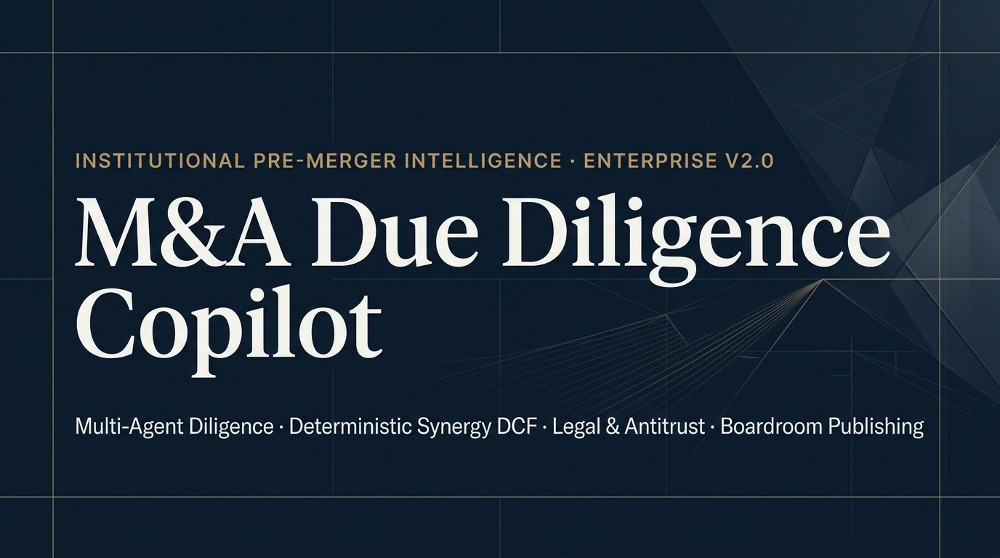

<br/>

[](https://www.python.org/)
[](app.py)
[](api/main.py)
[](tests/)
[](docs/TRUST_CENTER.md)
[](infra/k8s/deployment.yaml)

<br/>

### From 10,000-Page Virtual Data Room to Boardroom Conviction in Minutes.

**M&A Due Diligence Copilot (Enterprise v2.0)** is an institutional **Pre-Merger Intelligence, Quantitative Valuation, Legal Diligence & Deal Execution Platform** built for **Investment Banks, Private Equity Sponsors, and Corporate Development Teams**.

[Explore Flagship Use Cases](#flagship-institutional-use-cases) · [Product Tour](#visual-product-tour) · [Download Real Sample Deliverables](#real-boardroom-deliverables-generated-by-the-engine) · [Architecture](#enterprise-architecture) · [Quickstart](#quickstart) · [Trust Center & 100-Point Matrix](docs/TRUST_CENTER.md)

</div>

---

## Why This Platform Exists

Traditional M&A due diligence burns hundreds of analyst hours reconciling contradictory PDFs, manually extracting Change-of-Control clauses, chasing hardcoded plugs in target Excel models, and rebuilding Investment Committee pitchbooks the night before signing.

**M&A Due Diligence Copilot** separates **AI-driven evidence synthesis** from **100% deterministic financial & legal engineering**:

- **Zero Hallucinated Math:** Every dollar of Synergy NPV, 10,000-run Monte Carlo VaR, 3-Statement EPS Accretion/Dilution, PE LBO IRR/MOIC, QoE Normalized EBITDA, and Section 338(h)(10) Tax Step-Up is computed deterministically in Python — never by an LLM.
- **Zero Uncited Claims:** Every insight carries exact `[Source: filename | p.N]` provenance, audited by a **6-Agent Specialist Panel**, an **Adversarial Red-Team Skeptic**, a **Numerical Fact-Checker**, and a **Golden Evaluation Harness** (`A+`–`D`).
- **Bank-Grade Governance Built In:** 8-role RBAC, Deal-Level **Chinese Walls**, isolated **Clean Team Workbench**, reversible **PII/MNPI Redaction**, **Prompt-Injection Firewall**, and a tamper-evident **SHA-256 WORM Audit Chain**.
- **7-Format Boardroom Publishing:** One click exports an editable **12-Slide PowerPoint Pitchbook (`.pptx`)**, **IC Memo (`.docx`)**, **Live-Formula Wall Street Excel Model (`.xlsx`)**, **Boardroom HTML Brief**, **60-Second Red-Flag Flash**, **Jira PMI CSV**, and a **SHA-256-sealed Regulatory Audit Pack (`.zip`)**.

---

## Visual Product Tour

### 1. Workspace, Industrial VDR Ingestion & Live SEC EDGAR Auto-Fetch
Ingest entire `.zip` data rooms, native `.xlsx` models (with automatic formula/hardcode anomaly detection), `.pptx` CIMs, `.pdf` filings with page-aligned Markdown tables, or pull live `10-K`/`10-Q`/`8-K` filings directly from **SEC EDGAR** by ticker — or launch any of the **3 Flagship Case Studies** in one click.

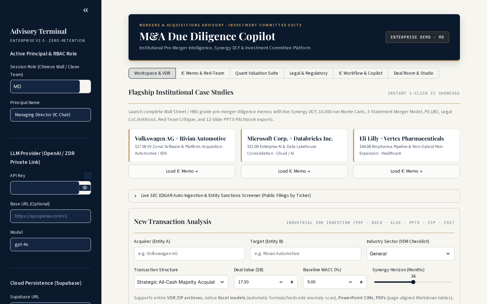

---

### 2. Investment Committee Memo, Grounding Telemetry & Multi-Agent Red-Team
<table>
  <tr>
    <td width="50%" valign="top">
      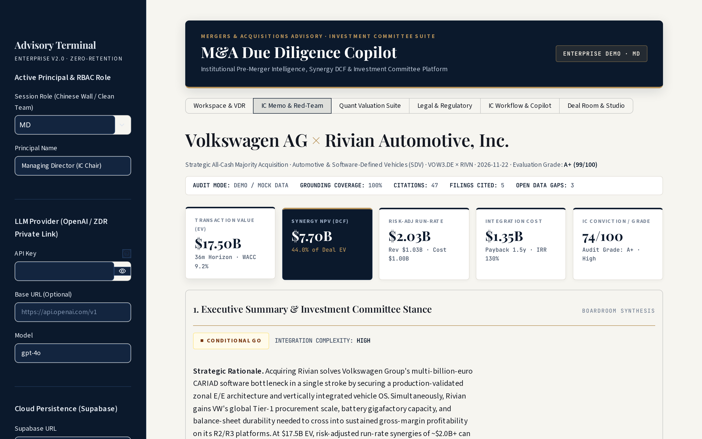
      <p align="center"><em><b>Executive Summary & MECE Conviction Radar</b> — 100% citation grounding bar, 5-card KPI terminal strip, and institutional audit grading.</em></p>
    </td>
    <td width="50%" valign="top">
      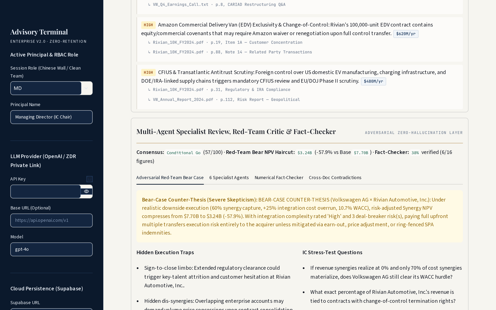
      <p align="center"><em><b>Adversarial Red-Team Critic & Fact-Checker</b> — 6 domain specialists + deterministic Bear-Case NPV haircut (-57.9%) and IC stress-test questions.</em></p>
    </td>
  </tr>
</table>

---

### 3. Deterministic Quant Valuation Suite (DCF, 10k Monte Carlo, Football Field, Merger Model, LBO & QoE)
<table>
  <tr>
    <td width="50%" valign="top">
      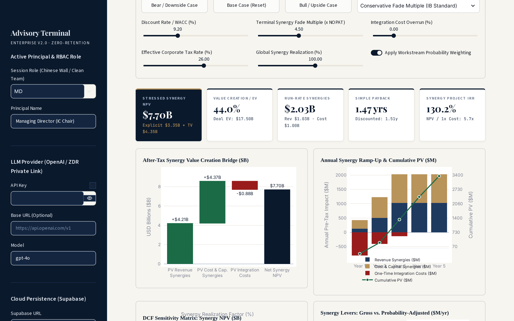
      <p align="center"><em><b>Synergy DCF & Value Creation Bridge</b> — Live WACC, tax, fade-multiple vs. perpetuity toggle, ramp-up phasing, and 2D sensitivity heatmap.</em></p>
    </td>
    <td width="50%" valign="top">
      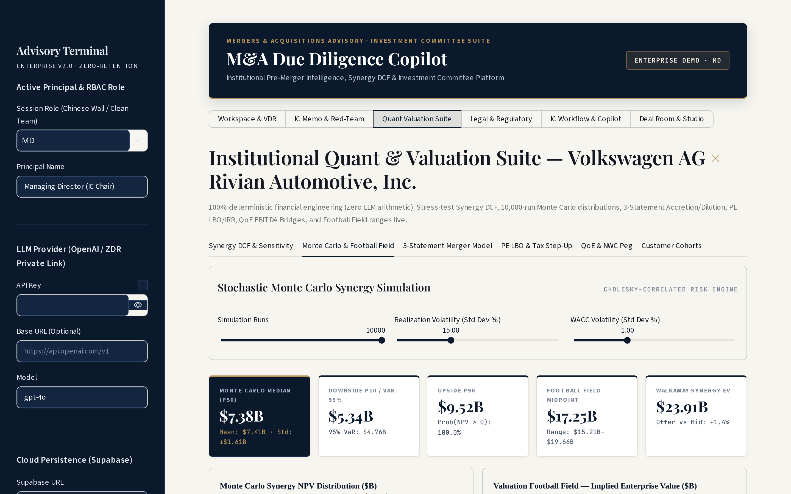
      <p align="center"><em><b>10,000-Run Correlated Monte Carlo & Football Field</b> — Cholesky-correlated P10/P50/P90 distributions, 95% VaR, and triangulated EV valuation ranges.</em></p>
    </td>
  </tr>
  <tr>
    <td width="50%" valign="top">
      
      <p align="center"><em><b>PE LBO Returns & Section 338(h)(10) Tax Step-Up</b> — Senior/Mezz debt sweep, Net Debt/EBITDA deleveraging, 5×5 Entry×Exit IRR sensitivity grid.</em></p>
    </td>
    <td width="50%" valign="top">
      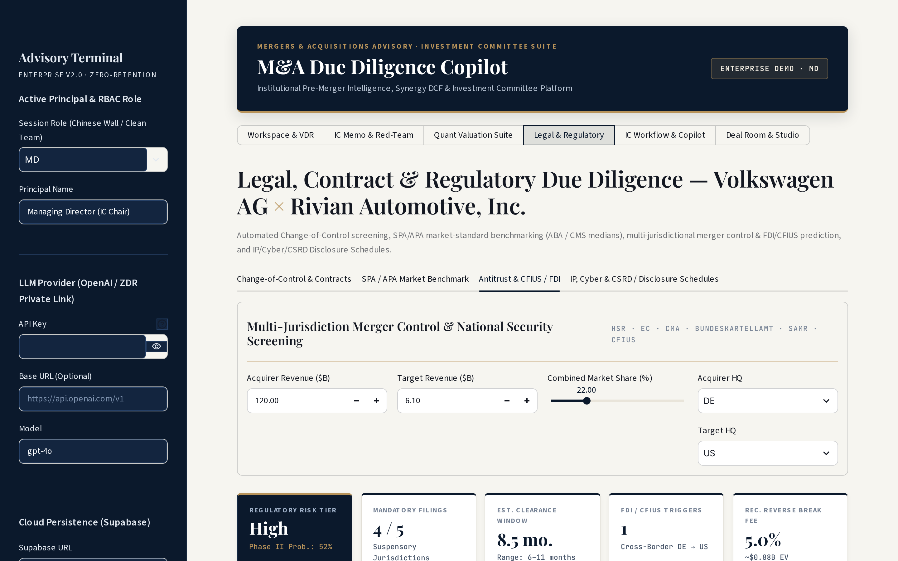
      <p align="center"><em><b>Global Antitrust, CFIUS/FDI & CoC Legal Engine</b> — HSR, EC, CMA, Bundeskartellamt & SAMR filing triggers, Phase II probability, and reverse break-fee sizing.</em></p>
    </td>
  </tr>
</table>

---

### 4. Multi-Deal Portfolio Benchmarking & Enterprise FastAPI v2.0 REST API
<table>
  <tr>
    <td width="50%" valign="top">
      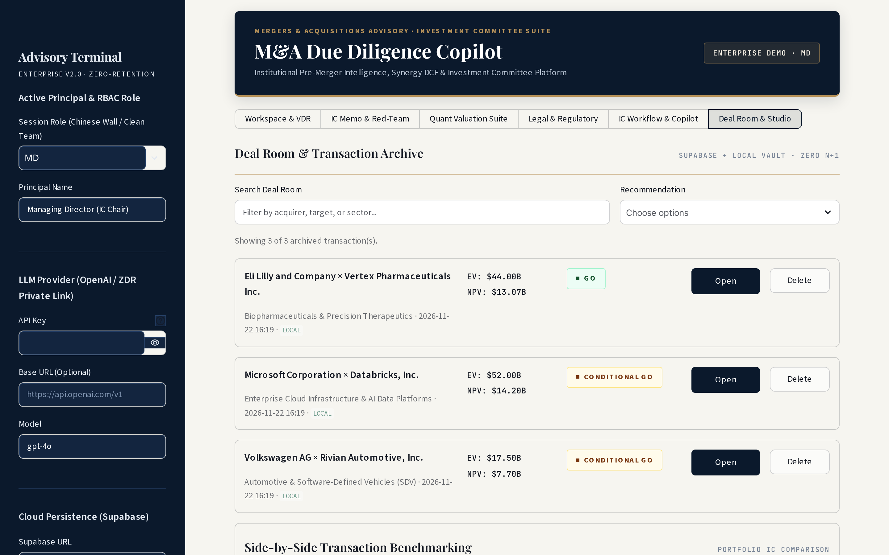
      <p align="center"><em><b>Deal Room Side-by-Side Benchmarking</b> — Compare EV vs. Synergy NPV, conviction scores, complexity, and grounding ratios across archived deals.</em></p>
    </td>
    <td width="50%" valign="top">
      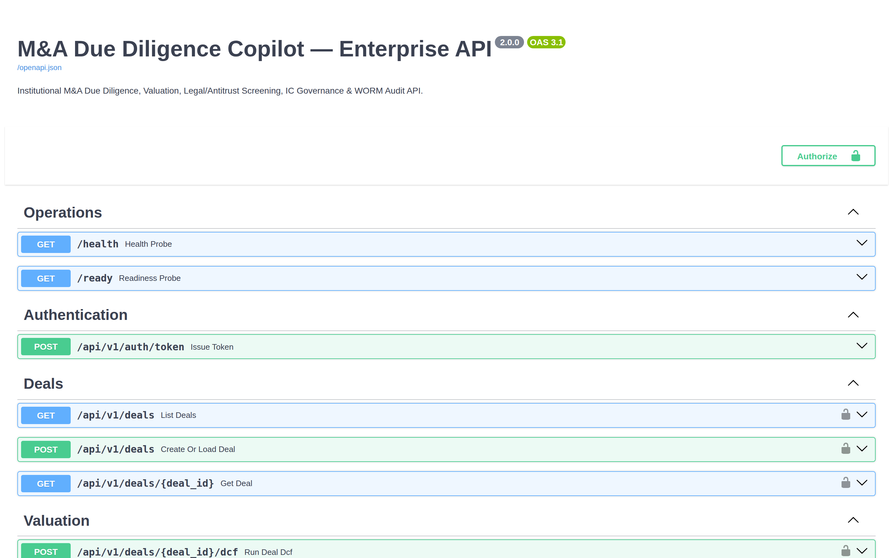
      <p align="center"><em><b>Enterprise FastAPI v2.0 REST & OpenAPI Docs</b> — JWT/RBAC-protected endpoints for Deals, DCF, Legal DD, Q&A, IC Votes, Exports & WORM Audit verification.</em></p>
    </td>
  </tr>
</table>

---

## Flagship Institutional Use Cases

Every figure below is computed live by the platform's deterministic valuation, legal, and multi-agent engines (reproducible offline in 2 seconds via `python docs/demos/run_live_demo.py`).

### Use Case 1 · Corporate M&A & Software-Defined Vehicle Turnaround
> **Volkswagen AG (`VOW3.DE`) × Rivian Automotive (`RIVN`)** — `$17.5B` Strategic All-Cash Majority Acquisition

| Metric | Engine Output | Investment Committee Implication |
|---|---|---|
| **IC Recommendation** | **Conditional Go** (`74/100` Conviction · Grade `A+`) | Requires Amazon EDV waiver, `$450M` 36m retention pool & CFIUS data enclave |
| **Synergy DCF NPV (Base)** | **`$7.70B`** (`44.0%` of EV · `1.47 yr` Payback) | Solves CARIAD bottleneck (`$2.03B/yr` risk-adjusted run-rate) |
| **Red-Team Bear Case NPV** | **`$3.24B`** (`-57.9%` haircut @ 60% capture, +150 bps WACC) | Highlights upfront multiple risk unless protected via SPA earn-out/indemnities |
| **Monte Carlo (10,000 runs)** | `P10: $5.03B` · `Median: $7.38B` · `P90: $9.89B` (`95% VaR: $4.39B`) | `100%` probability of positive NPV under correlated volatility |
| **Legal CoC & Antitrust** | `3` CoC flags (`$1,320M` Rev at Risk) · `4` Mandatory Filings | Mandatory HSR, EC, Bundeskartellamt, SAMR + **CFIUS** review (`~14 mo.`) |

**Sample Deliverables:** [12-Slide PPTX Pitchbook](docs/demos/IC_Pitchbook_VW_Rivian.pptx) · [IC Memo DOCX](docs/demos/IC_Memo_VW_Rivian.docx) · [Live-Formula Excel DCF](docs/demos/Synergy_DCF_VW_Rivian.xlsx) · [60-Sec Red-Flag Flash](docs/demos/Red_Flag_Flash_VW_Rivian.html)

---

### Use Case 2 · Hyperscaler AI Infrastructure Consolidation & Antitrust Remedies
> **Microsoft Corporation (`MSFT`) × Databricks, Inc. (`PRIVATE`)** — `$52.0B` Cash & Stock Acquisition

- **Strategic Thesis:** Unifies Databricks' Mosaic AI & Unity Catalog (`$3.0B+` ARR, `140%+` NDR) with Azure OpenAI & Microsoft Fabric, driving `$1.65B/yr` Azure GPU/compute pull-through.
- **Quantitative Outputs:** Base Synergy NPV **`$14.20B`** (`27.3%` of EV, `1.25 yr` payback), Monte Carlo Median **`$13.63B`**, Football Field Midpoint **`$53.8B`**, PE LBO Sponsor Floor IRR `25.6%` (`3.12x` MOIC).
- **Antitrust & Multi-Cloud Remedy Playbook:** Flags `CRITICAL` FTC / EC / CMA vertical-foreclosure scrutiny over Databricks' `~45%` AWS/GCP ARR base; automatically drafts a 10-year binding **Multi-Cloud Parity Commitment** and estimates `$2.5B–$3.0B` reverse termination fee exposure.
- **Sample Deliverable:** [Boardroom HTML Brief (Microsoft × Databricks)](docs/demos/Board_Brief_MSFT_Databricks.html)

---

### Use Case 3 · Large-Cap Biopharma Pipeline Diversification & Day-1 PMI Execution
> **Eli Lilly and Company (`LLY`) × Vertex Pharmaceuticals (`VRTX`)** — `$44.0B` Transformational All-Cash Acquisition

- **Strategic Thesis:** Hedges Lilly's GLP-1 concentration with Vertex's `$10.5B` high-margin Cystic Fibrosis franchise and plugs non-opioid pain launch (*suzetrigine*) into Lilly's `12,000+` global commercial reps.
- **Quantitative Outputs:** **Strong Go** (`85/100` Conviction), immediately **+13.19% Year-1 EPS accretive** (`$0M` breakeven synergies required!), Base Synergy NPV **`$13.07B`** (`29.7%` of EV, `1.0 yr` payback), Monte Carlo Median **`$12.56B`**, clean HSR/EC antitrust profile.
- **PMI Execution Export:** Ready-to-import Day-1 to Month-36 task backlog for Jira / Asana / Smartsheet.
- **Sample Deliverable:** [Jira / Asana PMI Backlog CSV (Eli Lilly × Vertex)](docs/demos/PMI_Jira_EliLilly_Vertex.csv)

---

### Use Case 4 · Private Equity Buyout & Confirmatory VDR Audit Playbook
> **Mid-Market Sponsor Buyout Workflow** (Automated Financial, Commercial & Legal Confirmatory Diligence)

1. **Drop Raw VDR ZIP + Excel Models:** [`vdr/ingestion.py`](vdr/ingestion.py) deduplicates files via SHA-256, classifies documents into 9 M&A folders, scores sector VDR completeness, and automatically catches **hardcoded plugs hidden inside Excel formula rows**, `#REF!`/`#DIV/0!` errors, and hidden adjustment sheets.
2. **Quality of Earnings, NWC Peg & Cohorts:** [`quant/qoe_nwc.py`](quant/qoe_nwc.py) constructs the Adjusted EBITDA waterfall, scores add-back credibility (`0–100`), computes LTM seasonal NWC Peg + Debt-like Items equity bridge, and runs Top-20 customer Pareto & NDR/GRR cohort diagnostics.
3. **Sponsor Returns & Tax Structuring:** [`quant/merger_lbo.py`](quant/merger_lbo.py) models Senior/Mezzanine debt sweeps, leverage covenants, 5×5 Entry×Exit IRR sensitivity grids, and Section 338(h)(10) Asset-vs.-Share Deal Tax Step-Up PV.
4. **Clean Team & IC Sign-Off:** [`workflow/deal_lifecycle.py`](workflow/deal_lifecycle.py) & [`api/auth.py`](api/auth.py) enforce `CLEAN_TEAM` role isolation for pre-closing pricing/customer data, track VDR Q&A answers, record formal IC votes, and hash every action into the tamper-evident **WORM SHA-256 Audit Log**.

---

## Real Boardroom Deliverables (Generated by the Engine)

Inspect real files produced directly by our publishing suite inside [`docs/demos/`](docs/demos/):

| Deliverable | File in Repo | Contents |
|---|---|---|
| **12-Slide IC Pitchbook** | [`docs/demos/IC_Pitchbook_VW_Rivian.pptx`](docs/demos/IC_Pitchbook_VW_Rivian.pptx) | Native widescreen PowerPoint with editable Synergy Bridge chart, 5-yr DCF table, color-shaded 2D WACC×Realization heatmap, Risk Matrix & PMI Roadmap |
| **IC Intelligence Memo** | [`docs/demos/IC_Memo_VW_Rivian.docx`](docs/demos/IC_Memo_VW_Rivian.docx) | Boardroom Word memo with Cover, Running Headers/Page Numbers, TOC field, Recommendation callout, MECE pillars & inline citations |
| **Wall Street DCF Model** | [`docs/demos/Synergy_DCF_VW_Rivian.xlsx`](docs/demos/Synergy_DCF_VW_Rivian.xlsx) | 4-sheet workbook with **live Excel formulas** (`=SUM`, discount factors, TV, Risk Scores) in IB color conventions (blue inputs, black formulas) |
| **Boardroom HTML Brief** | [`docs/demos/Board_Brief_MSFT_Databricks.html`](docs/demos/Board_Brief_MSFT_Databricks.html) | Self-contained, print-to-PDF-ready HTML investment brief |
| **60-Sec Red-Flag Flash** | [`docs/demos/Red_Flag_Flash_VW_Rivian.html`](docs/demos/Red_Flag_Flash_VW_Rivian.html) | Urgent 1-page Deal-Breaker alert memo with quantified risk exposure & CPs |
| **PMI Jira Backlog** | [`docs/demos/PMI_Jira_EliLilly_Vertex.csv`](docs/demos/PMI_Jira_EliLilly_Vertex.csv) | Direct Jira / Asana / Smartsheet CSV import for Post-Merger Integration |
| **1-Command CLI Demo** | [`docs/demos/run_live_demo.py`](docs/demos/run_live_demo.py) | Runs the entire 10-pillar pipeline end-to-end and seals an 8-file SHA-256 Audit Pack ZIP |

---

## Enterprise Architecture

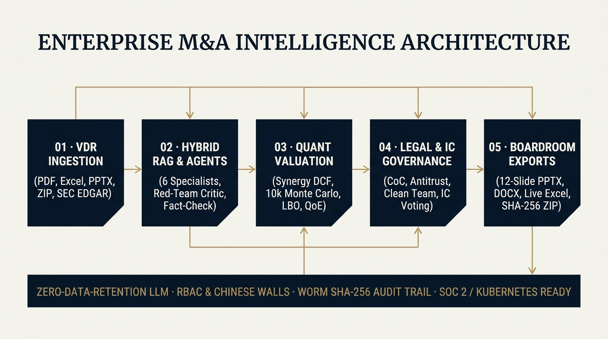

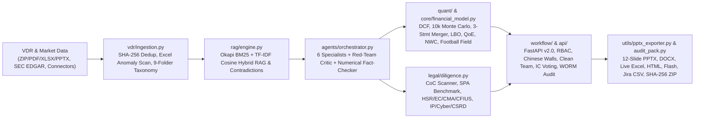

---

## Complete 10-Pillar Capability Matrix

> See **[docs/TRUST_CENTER.md](docs/TRUST_CENTER.md)** for the full **#01–#100 Traceability Matrix**, SOC 2 Type II / ISO 27001 / EU AI Act / GDPR controls, and ZDR LLM architecture.

| # | Pillar | Core Modules | Key Capabilities |
|---|---|---|---|
| **1** | **Enterprise API & Cloud Infra** | [`api/main.py`](api/main.py), [`Dockerfile`](Dockerfile), [`docker-compose.yml`](docker-compose.yml), [`infra/`](infra/) | FastAPI v2.0 + OpenAPI, Docker multi-stage non-root, Postgres/pgvector + Redis Compose, K8s HPA + NetworkPolicy, AWS Terraform (KMS CMEK / S3 / RDS / EKS), GitHub Actions CI |
| **2** | **Security, RBAC & WORM Audit** | [`api/auth.py`](api/auth.py), [`api/audit.py`](api/audit.py) | 8-role RBAC, Deal-level Chinese Walls, Clean Team isolation, HS256 JWT / OIDC mapper, reversible PII/MNPI redaction, Prompt-Injection firewall, tamper-evident SHA-256 WORM audit hash chain |
| **3** | **Industrial VDR Ingestion** | [`vdr/ingestion.py`](vdr/ingestion.py), [`utils/pdf_extractor.py`](utils/pdf_extractor.py) | Recursive ZIP/folder ingestion, SHA-256 dedup, native Excel formula/hardcode anomaly detector, PPTX extractor, page-aligned PDF Markdown tables, proportional context budgeting, 9-category taxonomy, sector completeness checklists, v1→v2 diff |
| **4** | **Hybrid RAG & Multi-Agent** | [`rag/engine.py`](rag/engine.py), [`agents/orchestrator.py`](agents/orchestrator.py) | Okapi BM25 + TF-IDF Cosine Hybrid Search, cross-document contradiction detector, 6 Specialist DD Agents, Adversarial Red-Team Critic, Deterministic Numerical Fact-Checker, Model Router, Golden Evaluation Harness (`A+`–`D`) |
| **5** | **Quant Valuation Suite** | [`core/financial_model.py`](core/financial_model.py), [`quant/`](quant/) | Synergy DCF (4.5x Fade Multiple & Perpetuity), 2D Sensitivity Heatmap, 10k Correlated Monte Carlo, Valuation Football Field, 3-Statement Merger Accretion/Dilution, PE LBO/IRR/MOIC, Section 338(h)(10) Tax Step-Up, QoE EBITDA Bridge, NWC Peg, Customer Cohorts |
| **6** | **Legal & Regulatory DD** | [`legal/diligence.py`](legal/diligence.py) | Change-of-Control / Anti-Assignment / MFN scanner with Revenue-at-Risk, ABA/CMS SPA Benchmark, HSR/EC/CMA/Bundeskartellamt/SAMR Antitrust & CFIUS/AWG/NSIA FDI predictor, IP/OSS/Cyber/CSRD Disclosure Schedules & CPs |
| **7** | **External Market Data** | [`vdr/connectors.py`](vdr/connectors.py) | Live **SEC EDGAR** ticker/CIK auto-ingestion (`10-K`/`10-Q`/`8-K`), OFAC/Sanctions & Entity Resolution screener, standardized connector registry (Datasite, Intralinks, SharePoint, Box, CapIQ, Bloomberg, PitchBook) |
| **8** | **Deal Execution & IC Portal** | [`workflow/deal_lifecycle.py`](workflow/deal_lifecycle.py) | 8-stage M&A lifecycle pipeline, integrated VDR Q&A tracker, Analyst claim sign-off, digital IC voting quorum portal, isolated Clean Team workbench, post-closing value-capture tracker, White-Label Branding & Playbook Studio, metering ledger |
| **9** | **Boardroom Publishing** | [`utils/pptx_exporter.py`](utils/pptx_exporter.py), [`utils/export_engine.py`](utils/export_engine.py), [`utils/audit_pack.py`](utils/audit_pack.py) | 12-Slide white-label `.pptx` Pitchbook, `.docx` IC Memo, live-formula `.xlsx` DCF Model, `.html` Board Brief, 60-sec Red-Flag Flash, Jira PMI `.csv`, EN/DE/FR/ES executive briefs, 8-file SHA-256 Audit Pack `.zip` |
| **10** | **Trust Center & Governance** | [`docs/TRUST_CENTER.md`](docs/TRUST_CENTER.md) | SOC 2 Type II / ISO 27001 / EU AI Act / GDPR control mapping, ZDR data-flow architecture, 100-Point Implementation Traceability Matrix |

---

## Quickstart

### Option 1 · Run Locally (UI + REST API + CLI Demo)

```bash
# 1. Clone & install
git clone https://github.com/JakobFerschin/ma-dd-copilot.git
cd ma-dd-copilot
python3 -m venv .venv
source .venv/bin/activate        # Windows: .venv\Scripts\activate
pip install -r requirements.txt

# 2. Run the 2-second end-to-end CLI demo (generates full Audit Pack ZIP offline)
python docs/demos/run_live_demo.py

# 3. Launch the Enterprise Investment Committee UI (Streamlit)
streamlit run app.py

# 4. Launch the Enterprise REST API + Interactive Swagger Docs (/docs)
uvicorn api.main:app --host 0.0.0.0 --port 8000
```

> **Zero-Config Demo Mode:** Runs immediately with zero API key using 3 flagship case studies, live deterministic Quant/Legal engines, offline Hybrid-RAG IC Q&A, Local Deal Vault, and all 7 export formats. Enter any OpenAI-compatible or Azure OpenAI ZDR key in the sidebar (or `.env`) to switch to **LIVE VDR analysis**.

### Option 2 · Enterprise REST API Example (`curl`)

```bash
# 1. Mint a role-scoped JWT token (MD / VP / ASSOCIATE / CLEAN_TEAM / AUDITOR)
TOKEN=$(curl -s -X POST http://localhost:8000/api/v1/auth/token \
  -H "Content-Type: application/json" \
  -d '{"username":"md@advisory.com","name":"IC Chair","role":"MD"}' | jq -r .access_token)

# 2. Load a flagship deal & run live stressed Synergy DCF + 5x5 sensitivity matrix
DEAL_ID=$(curl -s -X POST http://localhost:8000/api/v1/deals \
  -H "Authorization: Bearer $TOKEN" -H "Content-Type: application/json" \
  -d '{"demo_case_id":"vw_rivian"}' | jq -r .deal_id)

curl -s -X POST "http://localhost:8000/api/v1/deals/$DEAL_ID/dcf" \
  -H "Authorization: Bearer $TOKEN" -H "Content-Type: application/json" \
  -d '{"wacc_pct":9.5,"realization_factor_pct":90.0}' | jq .

# 3. Verify cryptographic WORM SHA-256 audit log integrity
curl -s http://localhost:8000/api/v1/audit/verify -H "Authorization: Bearer $TOKEN" | jq .
```

### Option 3 · Full Containerized Enterprise Stack (Docker Compose)

```bash
cp .env.example .env
docker compose up --build
# UI: http://localhost:8501  |  API Docs: http://localhost:8000/docs  |  Postgres (pgvector) + Redis
```

---

## Testing & Verification

```bash
python -m pytest tests/ -v
```

| Test Suite | Coverage | Status |
|---|---|---|
| [`tests/test_smoke.py`](tests/test_smoke.py) | Pydantic v2 MECE schema, mock analyzer, JSON roundtrip, provenance tags, DOCX export, hardened LLM parser | **10 / 10 Passed** |
| [`tests/test_institutional.py`](tests/test_institutional.py) | Page-aligned tables, proportional multi-doc budgeting, multi-format VDR extraction, DCF monotonicity, 2D sensitivity, live-formula Excel, HTML brief, Local Deal Vault, Supabase reset, IC Q&A, Plotly charts | **22 / 22 Passed** |
| [`tests/test_enterprise.py`](tests/test_enterprise.py) | Full Quant Suite (QoE/NWC/Cohorts/Merger/LBO/Tax/Football Field/Monte Carlo), Excel anomaly detection, ZIP dedup, Hybrid RAG, 6-Agent + Red-Team + Fact-Checker, Legal CoC/SPA/Antitrust/CFIUS, RBAC/Chinese Walls/PII Redaction, WORM Audit Tamper Detection, FastAPI E2E, 12-Slide PPTX & SHA-256 Audit Pack ZIP | **6 / 6 Passed** |

---

## Repository Structure

```text
ma-dd-copilot/
├── app.py                      # 6-workspace Enterprise Streamlit Investment Committee UI
├── api/                        # FastAPI v2.0 REST API, RBAC/Chinese Walls/PII Redaction, WORM SHA-256 Audit Log
├── quant/                      # QoE/NWC/Cohorts, 3-Statement Merger, PE LBO, Tax Step-Up, Football Field, 10k Monte Carlo
├── core/                       # Live/Mock LLM Analyzer, Deterministic Synergy DCF, Flagship Demo Cases, IC Q&A Copilot
├── agents/                     # 6 Specialist DD Agents, Adversarial Red-Team Critic, Numerical Fact-Checker, Golden Evaluator
├── rag/                        # Hybrid Okapi BM25 + TF-IDF Cosine RAG & Cross-Document Contradiction Detector
├── vdr/                        # Industrial ZIP/Excel/PPTX Ingestion, Formula Anomaly Detector, Live SEC EDGAR, Sanctions Screener
├── legal/                      # CoC Scanner, ABA/CMS SPA Benchmark, Global Antitrust & CFIUS/FDI, IP/Cyber/CSRD
├── workflow/                   # SQLite Enterprise Deal Lifecycle, VDR Q&A Tracker, IC Voting, Clean Team, White-Label Studio
├── utils/                      # 12-Slide PPTX Pitchbook, DOCX Memo, Live-Formula Excel, HTML Brief, SHA-256 Audit Pack ZIP
├── ui/                         # Private-Bank CSS Theme, 12 Institutional Plotly Charts, Quant & Legal/Workflow Views
├── db/                         # Credential-keyed Fail-Soft Supabase Client + Local Deal Vault
├── infra/                      # Kubernetes (HPA + NetworkPolicy) & AWS Terraform (VPC/KMS/S3/RDS/EKS)
├── docs/                       # Trust Center & 100-Point Matrix, Retina Screenshots (assets/), Real Deliverables (demos/)
└── tests/                      # 38 Automated Unit, Integration, Security & FastAPI E2E Tests
```
