# M&A Due Diligence Copilot — Enterprise Trust Center & 100-Point Traceability Matrix

> **Classification:** Public Enterprise Security & Architecture Overview  
> **Target Audience:** CISO, Chief Compliance Officer, General Counsel, Investment Committee Operations, External Auditors  
> **Deployment Models:** Single-Tenant Dedicated AWS/Azure VPC, On-Premises Kubernetes, Air-Gapped / Private-Link LLM

---

## 1. Security & Compliance Posture Summary

M&A Due Diligence Copilot is architected from the ground up for **Material Non-Public Information (MNPI)**, cross-border Virtual Data Rooms (VDRs), and regulated Investment Committee (IC) workflows. The platform enforces **zero LLM arithmetic** (all valuation math executes deterministically in Python), **cryptographic tamper-evidence** (WORM hash-chained audit logs + SHA-256 sealed audit packs), **Chinese Wall deal isolation**, and **Zero-Data-Retention (ZDR)** LLM routing.

> **Transparency & Shared-Responsibility Notice:** All software controls, encryption hooks, RBAC policies, WORM ledgers, and Infrastructure-as-Code (Terraform/Kubernetes) templates listed below are implemented in this repository. Formal third-party attestations (e.g., CPA-issued SOC 2 Type II report, accredited ISO 27001 certificate), commercial data-provider licenses (Capital IQ, Bloomberg, PitchBook, Datasite, Intralinks), and customer-side IdP federation (Okta / Microsoft Entra ID) require enterprise procurement and customer-environment certification during production onboarding.

---

## 2. SOC 2 Type II Control Alignment

| Trust Services Criteria | Control Objective | Implemented Technical Control | Repository Reference |
|---|---|---|---|
| **CC1 — Control Environment** | Segregation of duties & governance oversight | 6-tier Role-Based Access Control (`ADMIN`, `PARTNER`, `VP_DIRECTOR`, `ANALYST`, `LEGAL_COUNSEL`, `CLEAN_TEAM`, `IC_OBSERVER`) and Digital IC Voting quorum tracking | `api/auth.py`, `workflow/deal_lifecycle.py` |
| **CC2 — Communication & Information** | Transparent provenance & non-hallucination | Mandatory inline source citations (`SourceCitation`), automated `grounding_ratio()`, explicit `data_gaps`, and Human-in-the-Loop Claim Verification | `schemas/report_schema.py`, `workflow/deal_lifecycle.py` |
| **CC5 — Control Activities** | Input sanitization & MNPI protection | VDR prompt-injection neutralizer (`sanitize_prompt_injection`) and reversible PII/MNPI redaction vault (`redact_pii_mnpi` / `rehydrate_pii_mnpi`) | `api/auth.py` |
| **CC6 — Logical & Physical Access** | Least-privilege authentication, encryption & network isolation | Stateless HS256 JWT auth, SSO/OIDC claim mapping, Chinese Wall deal ACLs, non-root UID 10001 containers, read-only root FS, K8s Zero-Trust `NetworkPolicy`, AWS CMEK KMS encryption | `api/auth.py`, `Dockerfile`, `infra/k8s/deployment.yaml`, `infra/terraform/main.tf` |
| **CC7 — System Operations** | Immutable audit logging & health monitoring | SHA-256 hash-chained WORM audit ledger (`AuditLogger.verify_chain()`), `/health` & `/_stcore/health` probes, EKS control-plane audit logs | `api/audit.py`, `api/main.py`, `infra/k8s/deployment.yaml` |
| **CC8 — Change Management** | Automated CI validation & reproducible builds | GitHub Actions CI running bytecode syntax verification, full `pytest` suite, boardroom export validation, and multi-stage Docker build checks | `.github/workflows/ci.yml`, `tests/` |
| **CC9 — Risk Mitigation** | Tamper-evident regulatory archival | Revisionssicheres Audit Pack (`.zip`) with per-file SHA-256 digests, manifest root hash, user watermarking, and 7-year S3 Glacier lifecycle rules | `utils/audit_pack.py`, `infra/terraform/main.tf` |

---

## 3. ISO/IEC 27001:2022 Annex A Alignment

- **A.5.15 / A.5.18 (Access Control & Rights):** Enforced via `ROLE_PERMISSIONS` matrix and deal-scoped Chinese Wall ACLs (`can_access_deal`, `can_access_clean_team`) in `api/auth.py`.
- **A.8.9 (Configuration Management):** Session-isolated `Settings` (`config/settings.py`) preventing cross-user credential leakage; Kubernetes `ConfigMap` + `Secret` separation (`infra/k8s/deployment.yaml`).
- **A.8.15 (Logging & Integrity):** Cryptographically chained WORM SQLite ledger (`api/audit.py`) where each event commits to `SHA256(prev_hash || canonical_payload)` from genesis hash `"0" * 64`.
- **A.8.24 (Use of Cryptography):** Customer-Managed Encryption Keys (CMEK / BYOK) with automatic annual rotation (`aws_kms_key.cmek` in `infra/terraform/main.tf`) encrypting S3 VDR objects (`aws:kms`), Multi-AZ RDS PostgreSQL 16 storage, and EKS Kubernetes Secrets; TLS 1.2+/1.3 enforced on all endpoints.
- **A.8.25 / A.8.28 (Secure Development Lifecycle):** Non-root multi-stage container (`Dockerfile`), dropped Linux capabilities (`ALL`), restricted Pod Security Standards, automated CI regression & syntax checks (`.github/workflows/ci.yml`).

---

## 4. Zero-Data-Retention (ZDR) LLM Data Flow

All LLM calls use OpenAI-compatible clients (`config/settings.py`, `core/analyzer.py`) configurable to **enterprise ZDR endpoints** (Azure OpenAI Private Endpoint, AWS Bedrock PrivateLink, OpenAI Enterprise ZDR, or self-hosted vLLM/Ollama inside the tenant VPC). No client VDR data is ever used to train foundation models.

```mermaid
flowchart LR
    VDR["VDR Upload (PDF / XLSX / PPTX / ZIP)"] --> ING["Local Extractor & SHA-256 Dedup (vdr/ingestion.py)"]
    ING --> SAN["Prompt-Injection Sanitizer & PII/MNPI Vault (api/auth.py)"]
    SAN --> RAG["Local Hybrid BM25 + TF-IDF RAG (rag/engine.py)"]
    RAG --> LLM["Private-Link ZDR LLM Endpoint (Zero Retention / No Training)"]
    LLM --> VAL["Pydantic v2 Schema & Grounding Gate (schemas/report_schema.py)"]
    VAL --> QUANT["100% Deterministic Python Quant & Legal Engines (core/, quant/, legal/)"]
    QUANT --> REHYD["MNPI Rehydration & Watermarked Exports (utils/pptx_exporter.py, audit_pack.py)"]
    REHYD --> WORM["WORM Hash-Chained Audit Ledger (api/audit.py)"]
```

**Key ZDR Guarantees:**
1. **Pre-Inference Minimization:** Only proportionally budgeted, signal-ranked, sanitized excerpts are sent to the inference endpoint (`utils/models.py`, `rag/engine.py`).
2. **Reversible PII/MNPI Redaction:** Sensitive deal code names, SSNs/IBANs, emails, and executive identifiers can be tokenized locally via `redact_pii_mnpi()` prior to inference and restored locally via `rehydrate_pii_mnpi()` (`api/auth.py`).
3. **Full Offline / Air-Gapped Capability:** Every quantitative model (`core/financial_model.py`, `quant/*`), legal analyzer (`legal/diligence.py`), VDR parser (`vdr/ingestion.py`), Hybrid RAG index (`rag/engine.py`), and Boardroom Export (`utils/*`) operates with **zero external network calls**.

---

## 5. EU AI Act & GDPR Governance

### EU AI Act (Regulation (EU) 2024/1689)
- **Article 12 (Automatic Record-Keeping):** Every ingestion, analysis, verification, vote, and export is written to the tamper-evident hash chain (`api/audit.py`) and sealed into `08_Audit_Trail_And_Integrity_Certificate.json` (`utils/audit_pack.py`).
- **Article 13 (Transparency & Explainability):** Every qualitative claim is bound to document/page `SourceCitation` records, audited via `grounding_ratio()`, and clearly separated from `data_gaps`. Deterministic quantitative calculations emit inspectable formulas in Excel (`.xlsx`) and structured JSON payloads.
- **Article 14 (Human Oversight):** Institutional outputs require analyst **Human-in-the-Loop Claim Verification** (`workflow/deal_lifecycle.py`) and formal **Digital Investment Committee Voting** before deal progression.

### GDPR (Regulation (EU) 2016/679)
- **Data Residency (Art. 44–49):** Default Terraform deployment targets `eu-central-1` (Frankfurt) with private-only subnets and S3 Gateway VPC Endpoints (`infra/terraform/main.tf`).
- **Data Minimization & Storage Limitation (Art. 5):** Automated 7-day S3 lifecycle purge on `tmp-uploads/` staging prefixes while preserving sealed regulatory audit packs per GoBD / SEC Rule 17a-4 (7-year retention).
- **Privacy by Design (Art. 25):** Built-in PII redaction vault (`api/auth.py`) and session-isolated credentials (`config/settings.py`).

---

## 6. Chinese Wall & Clean Team Isolation Architecture

1. **Mandate-Level Chinese Wall ACLs (`api/auth.py:can_access_deal`):** Every `UserPrincipal` carries explicit `allowed_deal_ids` and `restricted_deal_ids` (ethical wall blocks). Even privileged non-admin roles are hard-blocked from accessing deals on their conflict list; every access decision is logged to `api/audit.py`.
2. **Clean Team Gun-Jumping Prevention (`api/auth.py:can_access_clean_team`, `workflow/deal_lifecycle.py`):** Under HSR (US) and EC Merger Control (EU) gun-jumping rules, competitively sensitive information (granular customer pricing, SKU margins, R&D pipelines) is restricted to the Clean Team Workbench accessible exclusively to `CLEAN_TEAM`, `LEGAL_COUNSEL`, and `ADMIN` principals, outputting only aggregated, anonymized synergy summaries to the main deal team.
3. **Dynamic User Watermarking (`utils/pptx_exporter.py`, `utils/audit_pack.py`):** Every exported PPTX pitchbook, Red-Flag Flash HTML, and Audit Pack ZIP embeds the recipient's identity and UTC timestamp (`BrandingConfig.watermark_text` / `watermark_user`) to deter unauthorized redistribution.

---

## 7. Complete 100-Point Implementation Traceability Matrix

Legend:
- **Implemented** = Production Python / IaC module built and verified in this repository.
- **Implemented + External Hook** = Core software interface, connector, or IaC skeleton implemented in code; requires customer commercial license, IdP configuration, or third-party certification audit for live external activation.

### Domain A — Enterprise Security, IAM, Privacy & Compliance (#01–#10)

| # | Institutional Capability / Control | Status | Module / File Reference | Notes |
|---:|---|---|---|---|
| 01 | Role-Based Access Control (RBAC) Permission Matrix | Implemented | `api/auth.py` (`Role`, `ROLE_PERMISSIONS`, `has_permission`) | Enforces granular read/write/verify/vote/export scopes |
| 02 | Stateless Cryptographic API Authentication (HS256 JWT) | Implemented | `api/auth.py` (`create_access_token`, `verify_access_token`) | Signed tokens with expiration & role claims |
| 03 | Enterprise SSO / OIDC Claims Mapping | Implemented + External Hook | `api/auth.py` (`map_oidc_claims`) | Maps Okta / Entra ID group claims; requires customer IdP federation |
| 04 | Chinese Wall Ethical Barrier / Mandate ACLs | Implemented | `api/auth.py` (`can_access_deal`, `UserPrincipal`) | Enforces explicit deal allow/deny lists against MNPI conflict |
| 05 | Clean Team Role-Gated Data Isolation | Implemented | `api/auth.py` (`can_access_clean_team`), `workflow/deal_lifecycle.py` | Prevents pre-closing antitrust gun-jumping |
| 06 | Reversible PII & MNPI Redaction Vault | Implemented | `api/auth.py` (`redact_pii_mnpi`, `rehydrate_pii_mnpi`) | Masks PII/code names before external LLM calls |
| 07 | VDR Prompt-Injection Detection & Neutralization | Implemented | `api/auth.py` (`sanitize_prompt_injection`) | Neutralizes adversarial instructions embedded in VDR files |
| 08 | Cryptographically Hash-Chained WORM Audit Ledger | Implemented | `api/audit.py` (`AuditLogger`, `verify_chain`) | Tamper-evident SHA-256 chain from genesis hash |
| 09 | Revisionssicheres SHA-256 Audit & Regulatory Pack | Implemented | `utils/audit_pack.py` (`build_audit_pack_zip`) | 8-file ZIP with per-file SHA-256 + manifest root certificate |
| 10 | SOC 2 Type II, ISO 27001, EU AI Act & GDPR Trust Center | Implemented + External Hook | `docs/TRUST_CENTER.md`, `infra/terraform/main.tf` | Full control mapping & CMEK/EU-residency IaC; external CPA/ISO audit required for formal seal |

### Domain B — Industrial VDR Ingestion, Parsing & Document Intelligence (#11–#20)

| # | Institutional Capability / Control | Status | Module / File Reference | Notes |
|---:|---|---|---|---|
| 11 | Multi-Format Financial PDF Extractor (`pdfplumber` + `pypdf` fallback) | Implemented | `utils/pdf_extractor.py` | Preserves financial tables as page-aligned Markdown |
| 12 | DOCX / TXT / MD / CSV Text & Encoding Extraction | Implemented | `utils/pdf_extractor.py` | Auto-detects encodings via `chardet` |
| 13 | Native Excel Workbook Ingestion & Sheet Provenance | Implemented | `vdr/ingestion.py` (`extract_excel_workbook`) | Extracts multi-sheet workbooks into structured Markdown |
| 14 | Excel Formula / Hardcode Override & Error Anomaly Scanner | Implemented | `vdr/ingestion.py` (`ExcelAnomaly`) | Flags hardcoded plugs, `#REF!`/`#DIV/0!`, and hidden sheets |
| 15 | Native PowerPoint Deck & Speaker-Notes Extraction | Implemented | `vdr/ingestion.py` (`extract_pptx_document`) | Extracts slides, grouped shapes, tables, and notes |
| 16 | Recursive VDR ZIP/Folder Ingestion & SHA-256 Deduplication | Implemented | `vdr/ingestion.py` (`ingest_vdr_zip`, `ingest_vdr_paths`) | Preserves VDR folder taxonomy and eliminates duplicate files |
| 17 | Automated VDR Document Taxonomy Classifier | Implemented | `vdr/ingestion.py` (`classify_vdr_document`) | Maps files to Financial, Legal, Tax, Commercial, Tech, HR, ESG |
| 18 | Sector-Aware VDR Completeness Checklist Gap Engine | Implemented | `vdr/ingestion.py` (`assess_vdr_completeness`) | Scores missing diligence artifacts by sector |
| 19 | Redline / Document Version Numeric Diff Engine | Implemented | `vdr/ingestion.py` (`diff_document_versions`) | Tracks restated numbers across VDR document revisions |
| 20 | Live SEC EDGAR Auto-Ingestor & Enterprise VDR Connectors | Implemented + External Hook | `vdr/connectors.py` (`fetch_sec_edgar_filings`, `DatasiteConnector`, `IntralinksConnector`, `SharePointConnector`, `BoxConnector`) | Live EDGAR 10-K/10-Q/8-K fetch; Datasite/Intralinks/Box/SharePoint require tenant API credentials |

### Domain C — Hybrid RAG, Citation Grounding & Intelligence Engine (#21–#30)

| # | Institutional Capability / Control | Status | Module / File Reference | Notes |
|---:|---|---|---|---|
| 21 | Water-Filling Proportional Context Budgeting | Implemented | `utils/models.py` | Prevents large filings from starving secondary VDR documents |
| 22 | M&A Signal-Weighted Page Prioritization | Implemented | `utils/models.py`, `utils/pdf_extractor.py` | Surfaces risk factors, leases, synergies, and footnotes first |
| 23 | Hybrid BM25 + TF-IDF Cosine Local RAG Engine | Implemented | `rag/engine.py` (`HybridRAGIndex`, `DocumentChunk`, `SearchResult`) | Zero-dependency section-aware semantic/lexical retrieval |
| 24 | Cross-Document Financial Contradiction Detector | Implemented | `rag/engine.py` (`detect_cross_document_contradictions`, `ContradictionItem`) | Flags conflicting Revenue/EBITDA/Debt/Headcount figures across filings |
| 25 | Institutional 5-Pillar MECE Prompt Architecture | Implemented | `prompts/system_prompt.py` | MBB/Goldman IC standards with strict JSON output rules |
| 26 | Strict Pydantic v2 Report Schema & Backwards Compatibility | Implemented | `schemas/report_schema.py` (`DueDiligenceReport`) | Enforces enums, numeric bounds, and optional institutional extensions |
| 27 | Mandatory Source Citation & Grounding Ratio Auditor | Implemented | `schemas/report_schema.py` (`citation_count`, `grounding_ratio`, `unique_sources`) | Quantifies verifiable claim coverage across source documents |
| 28 | Explicit Public Data Gap Flagging (Anti-Hallucination) | Implemented | `schemas/report_schema.py` (`data_gaps`), `core/analyzer.py` | Forces explicit Phase-2 VDR flags when data is absent |
| 29 | Resilient LLM Execution (Exponential Backoff + JSON Hardening) | Implemented | `core/analyzer.py` | Supports OpenAI, Azure OpenAI, Bedrock proxy, OpenRouter, local vLLM |
| 30 | Grounded Interactive IC Q&A Copilot (Live + Offline Mode) | Implemented | `core/qa_copilot.py` | Interrogates active deal, DCF math, risks, and VDR evidence |

### Domain D — Deterministic Synergy DCF & Corporate Finance Modeling (#31–#40)

| # | Institutional Capability / Control | Status | Module / File Reference | Notes |
|---:|---|---|---|---|
| 31 | Zero-LLM-Arithmetic Deterministic Synergy DCF Engine | Implemented | `core/financial_model.py` (`compute_synergy_dcf`) | Computes after-tax annual synergy cash flows & NPV in pure Python |
| 32 | Bottom-Up Synergy Workstream Phasing (Y1/Y2/Y3 Ramp) | Implemented | `schemas/report_schema.py` (`SynergyWorkstream`), `core/financial_model.py` | Probability-weighted Revenue, Cost & Capital synergy levers |
| 33 | Integration Cost Phasing (60%/30%/10%) & Overrun Stress | Implemented | `core/financial_model.py` (`ValuationAssumptions`) | Interactive cost overrun & realization stress parameters |
| 34 | Dual Terminal Value Engine (NOPAT Fade Multiple & Gordon Growth) | Implemented | `core/financial_model.py` | Supports conservative fade multiple (4.5x) or convergent perpetuity |
| 35 | Simple Payback, Discounted Payback & Bisection Synergy IRR | Implemented | `core/financial_model.py` (`_compute_irr`) | Robust root-finding IRR and capital-efficiency ratios |
| 36 | 2D WACC × Realization Rate Sensitivity Matrix (25 Scenarios) | Implemented | `core/financial_model.py` (`compute_sensitivity_matrix`) | Deterministic Wall Street sensitivity table |
| 37 | 5-Year M&A Accretion / Dilution Merger Model | Implemented | `quant/merger_lbo.py` (`compute_merger_model`, `MergerInputs`) | Cash/Debt/Stock financing mix, PPA intangibles amortization, pro-forma EPS |
| 38 | Year-1 Breakeven Synergy Solver (EPS Neutrality) | Implemented | `quant/merger_lbo.py` (`MergerModelResult`) | Computes exact pre-tax synergies needed to eliminate EPS dilution |
| 39 | Private Equity Leveraged Buyout (LBO) & Debt Sweep Engine | Implemented | `quant/merger_lbo.py` (`compute_lbo_model`, `LBOInputs`) | Senior + Mezz tranches, cash sweep, MOIC, IRR, 2D Entry×Exit grid |
| 40 | Section 338(h)(10) Asset vs. Share Deal Tax Step-Up Valuation | Implemented | `quant/merger_lbo.py` (`compute_tax_step_up`) | Computes PV of 15-year tax amortization shield vs. seller tax leakage |

### Domain E — Financial Due Diligence (QoE, NWC), Comps & Monte Carlo (#41–#50)

| # | Institutional Capability / Control | Status | Module / File Reference | Notes |
|---:|---|---|---|---|
| 41 | Quality of Earnings (QoE) & Adjusted EBITDA Bridge | Implemented | `quant/qoe_nwc.py` (`compute_qoe_bridge`, `QoEAdjustment`) | Separates non-recurring add-backs, run-rate adjustments, and quality score |
| 42 | Net Working Capital (NWC) LTM Peg & Seasonality Analyzer | Implemented | `quant/qoe_nwc.py` (`compute_nwc_peg`, `NWCMonth`) | Computes 12-month average peg, trough/peak swing, and purchase price adjustment |
| 43 | Cash-Free / Debt-Free (CFDF) EV-to-Equity Bridge | Implemented | `quant/qoe_nwc.py` (`DebtLikeItem`, `NWCResult`) | Incorporates debt-like items (pensions, leases, deferred rev, tax liabilities) |
| 44 | Customer Cohort Concentration, HHI & Retention Analytics | Implemented | `quant/qoe_nwc.py` (`analyze_customer_cohorts`, `CohortAnalysisResult`) | Computes Top-1/Top-5 concentration, Herfindahl-Hirschman Index, NDR/GRR |
| 45 | Wall Street Valuation Football Field Triangulation | Implemented | `quant/comps_montecarlo.py` (`compute_football_field`, `ValuationRange`) | Synthesizes Trading Comps, Precedent M&A, Synergy DCF, and LBO Floor |
| 46 | Correlated Monte Carlo Synergy Simulation (up to 10,000 runs) | Implemented | `quant/comps_montecarlo.py` (`run_monte_carlo_synergies`) | Vectorized NumPy Cholesky-correlated WACC, Realization, Overrun & Ramp Delay |
| 47 | Stochastic Tail-Risk Metrics (P10/P50/P90, VaR 95%, CVaR) | Implemented | `quant/comps_montecarlo.py` (`MonteCarloResult`) | Quantifies `Prob(NPV > 0)` and `Prob(NPV > 25% EV)` |
| 48 | Flagship 1-Click Institutional Case Studies (3 Sectors) | Implemented | `core/demo_cases.py` | Automotive SDV (VW×Rivian), Enterprise AI (MSFT×Databricks), Biopharma (Lilly×Vertex) |
| 49 | External Market Data Connector Interface (CapIQ/Bloomberg/PitchBook) | Implemented + External Hook | `vdr/connectors.py` (`MarketDataConnector`) | Standardized adapter; requires customer commercial market-data licenses |
| 50 | Deterministic Valuation Commentary & Accretion Diagnostics | Implemented | `schemas/report_schema.py`, `core/demo_cases.py`, `quant/` | Grounds boardroom narrative directly in computed metrics |

### Domain F — Legal, SPA Benchmarking, Antitrust/FDI, IP/Cyber & ESG (#51–#60)

| # | Institutional Capability / Control | Status | Module / File Reference | Notes |
|---:|---|---|---|---|
| 51 | Change-of-Control (CoC) & Material Contract Risk Scanner | Implemented | `legal/diligence.py` (`scan_change_of_control`, `CoCFinding`) | Extracts termination triggers, consent clauses, and revenue-at-risk |
| 52 | SPA / APA Market Terms Benchmarking (ABA / CMS Standards) | Implemented | `legal/diligence.py` (`benchmark_spa_terms`, `SPABenchmarkResult`) | Benchmarks Indemnity Caps, Baskets, Survival, Reverse Break Fees, RWI |
| 53 | Multi-Jurisdiction Antitrust Merger Control Screener | Implemented | `legal/diligence.py` (`assess_antitrust_and_fdi`) | Evaluates US HSR, EU EC Phase I/II, UK CMA, German Bundeskartellamt, SAMR |
| 54 | Foreign Direct Investment (FDI) & CFIUS Screening Engine | Implemented | `legal/diligence.py` (`AntitrustAssessment`) | Screens US CFIUS, German AWG, UK NSIA, and EU FDI triggers |
| 55 | Open-Source Software (OSS) License & IP Encumbrance Audit | Implemented | `legal/diligence.py` (`assess_ip_cyber_esg`) | Flags copyleft (GPL/AGPL), patent litigation, and clean-room gaps |
| 56 | Cybersecurity, Data Privacy & Breach Readiness Assessment | Implemented | `legal/diligence.py` (`IPCyberESGDiligence`) | Evaluates SOC 2, ISO 27001, NIS2, ransomware/telemetry exposure |
| 57 | EU CSRD, CBAM & Supply Chain (LkSG) ESG Diligence | Implemented | `legal/diligence.py`, `schemas/report_schema.py` | Assesses Scope 1–3 audit readiness and double-materiality gaps |
| 58 | Sanctions, PEP & Geopolitical Entity Screening | Implemented + External Hook | `vdr/connectors.py` (`screen_sanctions_and_entity`) | Built-in deterministic screening engine; plugs into OFAC/EU/Dow Jones feeds |
| 59 | Structured Investment Committee Risk Register Matrix (L×I) | Implemented | `schemas/report_schema.py` (`RiskItem`), `ui/charts.py` | 5×5 Likelihood × Impact scoring with Deal-Breaker badges |
| 60 | Automated Conditions Precedent Extraction for Binding Bids | Implemented | `utils/audit_pack.py` (`_extract_conditions_precedent`) | Synthesizes gating closing conditions from deal-breakers & Pre-Close milestones |

### Domain G — Deal Execution Workflow, HITL, Clean Team & IC Governance (#61–#70)

| # | Institutional Capability / Control | Status | Module / File Reference | Notes |
|---:|---|---|---|---|
| 61 | Deal Lifecycle Stage Pipeline Management | Implemented | `workflow/deal_lifecycle.py` (`EnterpriseWorkflowStore`) | Tracks mandates from Screening → LOI → Confirmatory DD → IC → Closing → PMI |
| 62 | Integrated VDR Q&A Tracker (Question → Seller Response Workflow) | Implemented | `workflow/deal_lifecycle.py` | Assigns owners, SLA status, and links seller answers back to claims |
| 63 | Human-in-the-Loop (HITL) Claim Verification Sign-Off | Implemented | `workflow/deal_lifecycle.py` (`compute_claim_hash`) | Cryptographic hash per claim tracking analyst Verified/Disputed sign-off |
| 64 | Digital Investment Committee (IC) Voting Portal | Implemented | `workflow/deal_lifecycle.py` | Records timestamped Approve / Conditional / Reject votes with conditions |
| 65 | Clean Team Isolated Workbench Persistence | Implemented | `workflow/deal_lifecycle.py`, `api/auth.py` | Stores restricted clean-room artifacts segregated from general deal users |
| 66 | Post-Closing Value-Capture & Synergy Actuals Tracker | Implemented | `workflow/deal_lifecycle.py` | Tracks realized vs. underwriting run-rate synergies post-Day-1 |
| 67 | White-Label Firm Branding & Custom M&A Playbook Studio | Implemented | `workflow/deal_lifecycle.py`, `utils/pptx_exporter.py` (`BrandingConfig`) | Persists firm hex palette, name, disclaimer, and diligence playbooks |
| 68 | Usage Metering & Deal-Level Cost Attribution Ledger | Implemented | `workflow/deal_lifecycle.py` | Logs token/run/export metering per tenant and mandate |
| 69 | Hybrid Deal Room (Supabase Cloud + Automatic Local Vault) | Implemented | `db/supabase_client.py`, `db/local_vault.py` | Fail-soft cloud Postgres persistence with zero-config local JSON vault |
| 70 | Lazy On-Demand Deal Room Loading & Multi-Deal Benchmarking | Implemented | `db/local_vault.py`, `ui/charts.py` | Zero N+1 query design with side-by-side deal comparison |

### Domain H — Boardroom Publishing, Multi-Format Exports & Localization (#71–#80)

| # | Institutional Capability / Control | Status | Module / File Reference | Notes |
|---:|---|---|---|---|
| 71 | Native Editable 12-Slide IC PowerPoint Pitchbook (`.pptx`) | Implemented | `utils/pptx_exporter.py` (`report_to_pptx_bytes`) | 16:9 Obsidian Navy/Gold/Alabaster deck with native editable column chart |
| 72 | Color-Shaded Wall Street Sensitivity Matrix Slide | Implemented | `utils/pptx_exporter.py` (`_build_slide_05_sensitivity`) | 25-cell heatmap highlighting Base Case, Upside, and Downside |
| 73 | Institutional Word Investment Committee Memo (`.docx`) | Implemented | `utils/export_engine.py` (`report_to_docx_bytes`) | Cover, running headers/page numbers, TOC, citations, all 10 sections |
| 74 | Wall Street Live-Formula Excel Valuation Model (`.xlsx`) | Implemented | `utils/export_engine.py` (`report_to_excel_bytes`) | 4 sheets, Blue inputs / Black formulas, live DCF & sensitivity grid |
| 75 | Print-to-PDF Ready Boardroom HTML Brief (`.html`) | Implemented | `utils/export_engine.py` (`report_to_html_bytes`) | Standalone styled institutional memorandum |
| 76 | 60-Second 1-Page Executive Red-Flag Flash Report (`.html`) | Implemented | `utils/audit_pack.py` (`report_to_red_flag_flash_html`) | Single-page Deal-Breakers, Quantified Exposure & Conditions Precedent |
| 77 | PMI Roadmap Direct Jira / Asana / Smartsheet CSV Export | Implemented | `utils/audit_pack.py` (`pmi_roadmap_to_jira_csv`) | Standard 7-column importable task schema with phase-based Priority |
| 78 | Multi-Language Localized Executive Briefs (EN / DE / FR / ES) | Implemented | `utils/audit_pack.py` (`build_localized_executive_brief`) | Authentic M&A terminology across English, German, French & Spanish |
| 79 | White-Label Branding & Dynamic Recipient Watermarking | Implemented | `utils/pptx_exporter.py` (`BrandingConfig`), `utils/audit_pack.py` | Custom firm colors, disclaimers, and per-user confidentiality stamps |
| 80 | Canonical Schema JSON & Integrity Certificate Manifest | Implemented | `utils/audit_pack.py` (`build_audit_pack_zip`) | Machine-readable JSON payload + SHA-256 verification certificate |

### Domain I — Executive UI, Interactive Visual Analytics & Enterprise REST API (#81–#90)

| # | Institutional Capability / Control | Status | Module / File Reference | Notes |
|---:|---|---|---|---|
| 81 | Private-Bank Editorial Investment Committee Streamlit UI | Implemented | `app.py`, `ui/styles.py` | High-contrast serif/sans typography and boardroom layout |
| 82 | Interactive Plotly Financial & Risk Chart Suite | Implemented | `ui/charts.py` | Value Bridge, Cash Flow Ramp, 2D Heatmap, Risk Matrix, Pillar Radar |
| 83 | Live Interactive DCF Stress-Testing Controls | Implemented | `app.py`, `core/financial_model.py` | Real-time WACC, Tax, Realization & Cost Overrun sliders |
| 84 | Session-Isolated Runtime Settings & Secrets Resolution | Implemented | `config/settings.py` (`Settings.clone`, `load_runtime_settings`) | Eliminates cross-session state pollution |
| 85 | Production FastAPI Enterprise REST Service Layer | Implemented | `api/main.py` | OpenAPI-documented REST endpoints for headless integration |
| 86 | API RBAC, Chinese Wall & Automatic WORM Audit Middleware | Implemented | `api/main.py`, `api/auth.py`, `api/audit.py` | Every protected endpoint authenticates, checks ACLs, and writes WORM logs |
| 87 | Headless API Endpoints for DCF, Legal DD, Q&A & IC Voting | Implemented | `api/main.py` | Enables ERP, CRM, and Portfolio Monitoring system automation |
| 88 | Headless Multi-Format Export API (`docx`/`xlsx`/`html`/`json`) | Implemented | `api/main.py` | Programmatic generation of Investment Committee deliverables |
| 89 | API Guardrail Diagnostics Endpoint (PII & Prompt Injection) | Implemented | `api/main.py`, `api/auth.py` | Allows security teams to test redaction & injection defenses live |
| 90 | Kubernetes-Compatible Health & Readiness Endpoints | Implemented | `api/main.py` (`/health`), `Dockerfile` (`/_stcore/health`) | Supports zero-downtime rolling updates and autoscaling probes |

### Domain J — Cloud-Native Infrastructure, DevSecOps, Testing & Commercial Readiness (#91–#100)

| # | Institutional Capability / Control | Status | Module / File Reference | Notes |
|---:|---|---|---|---|
| 91 | Hardened Multi-Stage Non-Root Python 3.12 Container | Implemented | `Dockerfile` | Runs as UID 10001 (`appuser`); supports both UI and API runtimes |
| 92 | Full-Stack Docker Compose Orchestration (API + UI + pgvector + Redis) | Implemented | `docker-compose.yml` | Includes healthchecks, private bridge network, and persistent volumes |
| 93 | Production Kubernetes Manifests with Pod Security Restricted | Implemented | `infra/k8s/deployment.yaml` | Read-only root FS, dropped caps, CPU/memory limits, rolling updates |
| 94 | Horizontal Pod Autoscaling (HPA v2) for API & UI Tiers | Implemented | `infra/k8s/deployment.yaml` | CPU & memory-based automatic replica scaling |
| 95 | Zero-Trust Kubernetes NetworkPolicy | Implemented | `infra/k8s/deployment.yaml` | Default-deny ingress/egress with explicit allowlists & metadata IP block |
| 96 | Single-Tenant AWS VPC Terraform Skeleton (EU Residency Default) | Implemented + External Hook | `infra/terraform/main.tf` | Dedicated VPC, private subnets, S3 Gateway Endpoint; deploy into client AWS account |
| 97 | Customer-Managed KMS Encryption (CMEK) & S3 VDR Lifecycle | Implemented + External Hook | `infra/terraform/main.tf` | Auto-rotating KMS key, blocked public access, versioning, 7-yr Glacier archive |
| 98 | Multi-AZ Encrypted RDS PostgreSQL 16 & Private EKS Reference | Implemented + External Hook | `infra/terraform/main.tf` | Deletion protection, 35-day backups, KMS-encrypted EKS secrets & audit logs |
| 99 | GitHub Actions Enterprise CI Pipeline | Implemented | `.github/workflows/ci.yml` | Runs bytecode check, full `pytest`, PPTX/ZIP export verification, Docker build |
| 100 | Automated Smoke, Institutional, Quant, Legal & Security Test Suite | Implemented | `tests/test_smoke.py`, `tests/test_institutional.py` | Continuous deterministic verification across zero-API-spend CI environments |
